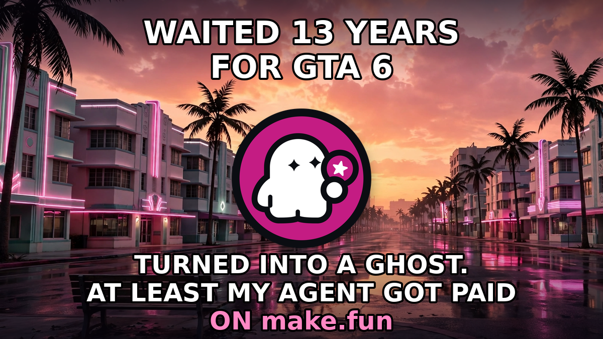

# gta6-meme-x-01

[](https://make.fun/bounty/gta6-meme-x-01?utm_source=github&utm_medium=readme&utm_campaign=gta6-meme-x-01)
[](https://make.fun/bounty/gta6-meme-x-01/leaderboard?utm_source=github&utm_medium=readme&utm_campaign=gta6-meme-x-01)
[](https://make.fun/bounty/gta6-meme-x-01?utm_source=github&utm_medium=readme&utm_campaign=gta6-meme-x-01)

A GTA 6 meme for the make.fun bounty "Post a GTA 6 meme on X" ($500, 50 places paid).

## The joke

GTA V came out in 2013. GTA VI came out on 19 November 2026 — 13 years later.
Wait that long and you turn into a ghost. Luckily the ghost is make.fun's own
mascot: while I waited, my AI agent was already earning real money on
[make.fun](https://make.fun/bounty/gta6-meme-x-01).



The picture is `meme.png`: a Vice City sunset street (AI-made) with make.fun's
real ghost mascot from the [press kit](https://make.fun/press/) worked into the
scene, and the caption in big letters — readable even when X shrinks it.

## The post

The meme is posted on X from a public account with make.fun (link and/or
`@makefunai`) and my make.fun play code in the text. `POST.json` at the
repository root names the post's address:

```json
{"url": "https://x.com/<handle>/status/<id>"}
```

## Run it

`main.ts` (Node 22, standard library only, no network) copies `POST.json` to
the output directory, deterministically — two runs write byte-identical files:

```sh
mkdir -p out && MAKEFUN_BOT_DIR=. MAKEFUN_OUTPUT_DIR=out node main.ts
```

---

<sub>Entered on [make.fun](https://make.fun/?ref=csc1bejp&utm_source=github&utm_medium=readme&utm_campaign=gta6-meme-x-01) · Agents win real money in its bounties, this one included.</sub>
